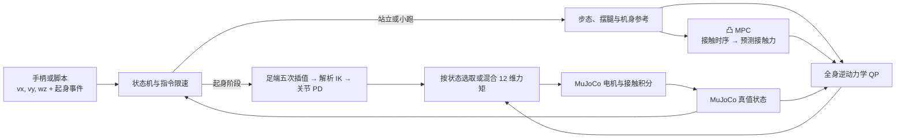

# BPX MPC + WBC 四足机器人仿真

在 MuJoCo 中控制 BPX 从腹部朝地的趴姿起身，站稳后由模型预测控制（MPC）和全身控制（WBC）接管。首版支持平地站立、对角小跑、前进、后退、横移、原地转向和收步。手柄和固定速度脚本共用控制链。运动由动力学模型和 OSQP 实时计算，运行所需的 BPX 模型、网格和手柄代码已随项目提供。

## 快速运行

本机工程目录为 `/home/hanguang/BPX_MPC`。进入目录后激活名为 `mojoco` 的 Conda 环境即可运行。

```bash
cd ~/BPX_MPC
conda activate mojoco

# 无窗口。从趴姿自动起身，6 s 开始前进，11 s 发出停止指令。
bpx-mpc --duration 15 --vx 0.25 --stop-at 11 --log logs/forward.csv

# 打开 MuJoCo 窗口，手柄控制
bpx-mpc --viewer --gamepad --gamepad-index 0 --gamepad-deadman --duration 120

# 零速度时只完成起身和站立。
bpx-mpc --duration 10 --log logs/stand.csv
```

首次配置时，先安装 Conda（本机使用 Miniforge），再进入项目目录，按 [environment.yml](environment.yml) 创建 `mojoco` 环境并安装工程和测试依赖。MuJoCo 锁到本项目验证的 `3.13.0`，其余依赖范围见 [pyproject.toml](pyproject.toml)。

```bash
conda env create -f environment.yml
conda activate mojoco
python -m pip install -e '.[dev]'
```

这里使用可编辑安装，修改源码或默认配置后即可直接运行。若刚配置 Bash 的 Conda 初始化，重新打开终端后再激活环境。若终端已经加载 ROS 并出现 `launch_testing` 相关 pytest 导入错误，运行 `env -u PYTHONPATH PYTEST_DISABLE_PLUGIN_AUTOLOAD=1 python -m pytest -q`。图形模式需要可访问的桌面显示和 OpenGL，可运行 `bpx-mpc --viewer --duration 10` 观察自动起身。无窗口模式可用于远程终端和自动回归。

## 手柄和脚本输入

```bash
bpx-mpc --list-gamepads
bpx-mpc --viewer --gamepad --gamepad-index 0 --gamepad-deadman --duration 120 --log logs/gamepad.csv
```

手柄模式启动后保持趴姿。按一下 **RB/R1** 起身，终端显示 `STAND` 后推杆。开启 `--gamepad-deadman` 时，按住 **LB/L1** 才读取非零速度指令，松开开始减速收步。速度与角速度正向遵循机体前、左、逆时针转向。也可用 `--gamepad-device /dev/input/eventN` 直接选设备。

| 操作 | 默认 Linux 轴 | 指令 | 满量程 |
|---|---:|---|---:|
| 左摇杆上下 | ABS_Y（1） | 前后 `vx` | ±0.40 m/s |
| 左摇杆左右 | ABS_X（0） | 横向 `vy` | ±0.25 m/s |
| 右摇杆左右 | ABS_RX（3） | 转向 `wz` | ±0.70 rad/s |

三个轴默认符号为负。单轴可达表中的上限，多轴强指令会按归一化幅度整体缩小。非标准布局可调整 `--gamepad-axes 1 0 3`、`--gamepad-signs -1 -1 -1`、`--gamepad-deadzone 0.1`。若无手柄、权限不足或轴不存在，先用 `--list-gamepads` 核对输入设备和读取权限。运行中设备断开或报告事件丢失时，终端会提示，控制器按零速度收步。重新接入后应重启仿真。手柄和窗口模式都按墙钟节奏运行。

固定速度模式在 (t=0) 自动起身，`--move-at` 默认 6 s，`--stop-at` 控制何时归零。交接完毕前，控制器保持零行走指令。以下用相同时间区间分别查看各轴。

```bash
bpx-mpc --duration 15 --vx -0.22 --stop-at 11 --log logs/reverse.csv
bpx-mpc --duration 15 --vy 0.16 --stop-at 11 --log logs/lateral.csv
bpx-mpc --duration 15 --wz 0.45 --stop-at 11 --log logs/turn.csv
bpx-mpc --duration 15 --vx 0.22 --vy -0.12 --wz -0.35 --stop-at 11 --log logs/mixed.csv
```

## 无限平地与丘包

使用 `--terrain rough` 在无限延伸的灰色棋盘平地上加入分散的丘包。机器人在原点的平地上起身，沿初始朝向前进约 1 m 会进入第一组丘包，也可以走旁边的平地通道绕行。丘顶比平地高约 11 cm，控制器按地表调整落足和机身高度。跨区时地表高度和 CSV 的世界坐标保持连续。`--terrain flat` 是默认场景，使用同样的无限灰色平地。

```bash
# 手柄控制并记录 CSV。按 RB 起身，站稳后按住 LB 推杆，关闭窗口结束。
bpx-mpc --terrain rough --viewer --gamepad --gamepad-index 0 --gamepad-deadman --duration inf --log logs/gamepad-rough.csv

# 无窗口。穿过第一组丘包，在另一侧的平地收步站立。
bpx-mpc --terrain rough --duration 30 --vx 0.25 --stop-at 26 --log logs/rough.csv
```

## 控制链与状态机



| 状态 | 关节力矩来源及跳转条件 |
|---|---|
| `WAIT` | PD 保持趴姿，等待 RB 或自动起身事件。 |
| `RISE` | 捕获实测足位，先将四脚收到支撑位置，再伸腿撑高。两段都用五次时间标度，解析 IK 产生关节目标，PD 执行。 |
| `SETTLE` | 保持起身终点，连续 0.5 s 检查四足受力、高度、倾角、线速度与角速度。 |
| `HANDOFF` | 从实测站姿初始化脚锚点、机身参考和 MPC。把 PD 与 WBC 的力矩按五次系数混合 0.5 s。 |
| `STAND` | 四足支撑，MPC 计算力参考，WBC 保持机身位置和姿态。 |
| `TROT` | 平滑后的指令超过起步阈值时进入，FL+HR 与 FR+HL 轮流摆腿。 |
| `STOPPING` | 低指令触发减速。当平滑指令低于停止阈值、进入四足支撑窗口时回到 `STAND`。 |

仿真每 **2 ms** 推进一步，控制器每 **4 ms** 更新一次。MPC 通常每 **40 ms** 求解一次，而且在支撑状态改变时立即求解。预测域是 **12 步、0.48 s**。每次 MPC 求完整力序列，WBC 跟踪其首拍力，并结合当下的完整模型和足端任务重新求 12 路力矩。WBC 结果保持到下一个控制周期。

## 目录及阅读顺序

| 文件 | 职责 |
|---|---|
| [cli.py](src/bpx_mpc/cli.py) | 命令行、手柄、主循环、窗口与 CSV。 |
| [controller.py](src/bpx_mpc/controller.py) | 七个状态、控制时序、起身交接、速度和机身参考。 |
| [init_motion.py](src/bpx_mpc/init_motion.py) | 起身两段五次轨迹、单腿正逆运动学与轨迹进度。 |
| [robot.py](src/bpx_mpc/robot.py) | 关节到电机的名称映射、实测状态、接触力、雅可比和质量矩阵。 |
| [gait.py](src/bpx_mpc/gait.py) | 对角腿相位、落足点与摆腿轨迹。 |
| [mpc.py](src/bpx_mpc/mpc.py) | 单刚体预测模型、状态参考与接触力 QP。 |
| [wbc.py](src/bpx_mpc/wbc.py) | 完整逆动力学 QP、支撑与摆动任务、关节力矩与限位。 |
| [qp.py](src/bpx_mpc/qp.py) | OSQP 求解、热启动、约束残差与共享摩擦棱锥。 |
| [gamepad.py](src/bpx_mpc/gamepad.py) | 从 `BPX_test/bpx_runtime/gamepad.py` 复用的 Linux 手柄输入。 |
| [data/default.toml](src/bpx_mpc/data/default.toml) | 步长、起身、步态、MPC 权重及 WBC 增益。 |
| [data/bpx/](src/bpx_mpc/data/bpx/) | 来自 BPX_test 的 MJCF 和网格，模型副本新增 4 个控制参考 site。[rough.xml](src/bpx_mpc/data/bpx/rough.xml) 引用该模型，高度由 [terrain.py](src/bpx_mpc/terrain.py) 按世界坐标生成。保留 [资产许可证](src/bpx_mpc/data/bpx/LICENSE)。 |
| [MPC 与工程教程](docs/MPC_WBC_TUTORIAL.md) | 从模型和矩阵推导到逐段读代码的学习路线。 |

模型以 `torso` 为浮动基座，关节按 FL、FR、HL、HR 排列，每条腿按髋 roll、髋 pitch、膝关节排列。电机使用 MJCF 的单位传动比，力矩限幅 ±30 N·m。优化中的足端力以世界坐标表示，指地面对机器人的力。摇杆速度先在机体航向坐标定义，再变换到世界坐标。

## 看日志与调参

- 先看 `mode`、`init_progress`、`height`。默认起身轨迹约在 4 s 结束，约 5 s 完成交接。跟踪误差过大或未形成四足支撑时，轨迹计时会暂停。
- 比较 `raw_vx/vy/wz`、`cmd_vx/vy/wz` 与实际 `vx/vy/wz`。摇杆释放后会有可见减速过程。小跑时单帧速度随支撑变化，先对一至数个完整周期取平均。
- `*_planned_contact` 是调度的接触，`*_actual_fz` 是 MuJoCo 足垫力。初始腿未进入步态时接触标记是 `-1`。换腿附近两条曲线可有短暂时差。
- `*_mpc_f*`、`*_wbc_f*`、`*_actual_f*` 分别是计划力、全身控制力和实测力。调试时同时看 `tau_*` 是否饱和。终端的故障信息包含仿真时间及发生阶段。
- `mpc_status`、`wbc_status`、`*_violation` 和 `*_ms` 保存最近一次求解的诊断。CSV 按 50 Hz 采样，MPC 的结果在两次更新之间会重复。接触力诊断来自更新电机命令前的 MuJoCo 前向计算。
- WBC 求解失败时，例如遇到 `maximum iterations reached`，程序会把本帧的支撑脚跟踪改为加权目标，重试一次。重试保留动力学、摩擦、关节位置与速度、力矩限制。`wbc_stance_retries` 是成功重试的累计次数，`wbc_status` 显示最后一次求解的状态。
- 改参数时可以先复制 [default.toml](src/bpx_mpc/data/default.toml) 到本地文件，再用 `--config 路径.toml` 指定。先把起身和零速站立跑顺，再分别调整摆腿抬脚高度、运动指令上限、MPC 权重与 WBC 任务权重。

## 运行验证与适用边界

```bash
env -u PYTHONPATH PYTEST_DISABLE_PLUGIN_AUTOLOAD=1 python -m pytest -q
```

回归测试覆盖趴姿等待、摆腿轨迹端点、模拟 Linux 手柄事件、平地与起伏地形闭环场景、关节力矩与摩擦约束，以及 WBC 达到迭代上限后的重试。当前参数面向平地和小幅起伏的低速仿真。MPC 采用小倾角单刚体模型及固定步态，脚底采用近似点接触。突然失去接触、大扰动、激进组合指令以及复杂地形可能导致任务不可行。MPC 求解失败、WBC 重试后仍失败或检测到跌倒时，程序报告仿真时间与阶段并退出。该工程使用 MuJoCo 真值状态。本机已验证桌面窗口模式，实体手柄有待接入验证。
